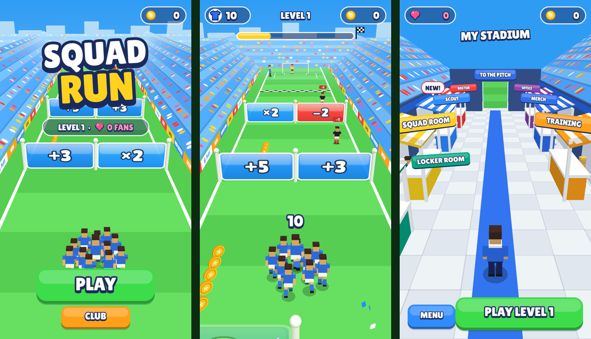

# Squad Run

A portrait soccer runner built for [YouTube Playables](https://developers.google.com/youtube/gaming/playables). Steer a squad through math gates, dodge defenders, win the penalty shootout, then grow your club and your stadium between levels.



## The game

- **Run:** drag (or use the arrow keys) to steer your squad through gates that add, subtract, multiply or divide it. Defenders knock players out, and coins line the way.
- **Shootout:** every level ends in penalties. Each player who survives the run is another shot at goal.
- **Club:** after each level, walk your manager around your stadium concourse. Sign star players at the Scout and look after them at the Doctor, run campaigns at the Office, train the squad, buy kits at the Merch stall, and pick outfits and goal celebrations in the Locker Room.
- **Fans** are your score. As they grow, so does the stadium: club-coloured stands, then an upper tier, a roof and floodlights.

Levels are generated from the level number, so level *n* is always the same.

## Tech

- **TypeScript**, built with **Vite**
- **Three.js** for the 3D gameplay, drawn under a transparent **Phaser 3** canvas that handles menus, HUD and input
- **No asset files** besides one font: textures are drawn on canvas and sound effects are synthesized with Web Audio
- **Vitest** for the game rules, which are kept free of Phaser and Three.js so they can be tested in Node

## Running it

Requires Node.js 18 or newer.

```bash
npm install
npm run dev        # dev server on http://localhost:8080
```

| Command | What it does |
|---|---|
| `npm run dev` | Dev server with hot reload |
| `npm test` | Run the unit tests |
| `npm run typecheck` | Type-check only |
| `npm run build` | Type-check and build to `dist/` |
| `npm run phone` | Build and serve on your local network, to play on a phone |
| `npm run capture` | Headless screenshots of any scene into `.captures/` (Playwright) |

Useful URL parameters:

- `?mock` (dev only): a fake Playables SDK with a debug panel to trigger pause, mute, ads and save failures
- `?scene=Stadium` or `?scene=Game&level=20` (dev only): jump straight to a scene
- `?fps`: a frame-rate meter, also in production builds

## YouTube Playables

All platform calls go through [`src/sdk/Playables.ts`](src/sdk/Playables.ts), and every call is a no-op outside YouTube. The integration covers loading signals, cloud saves, score reporting, pause and resume, YouTube's audio setting, interstitial ads between levels, and opt-in rewarded ads. The production build is about 0.5 MB compressed.

To test it on YouTube, run `npm run build`, zip the **contents** of `dist/`, and upload the zip in the Playables Developer Portal. [`docs/release/device-checklist.md`](docs/release/device-checklist.md) lists the checks to run before submitting.

## Project layout

```
src/
  game/      pure gameplay rules: level generation, gates, scoring, formation
  club/      pure club and stadium rules: stars, economy, concourse, wardrobe
  state/     save data and progress
  scenes/    Phaser scenes: title, run, overlays, stadium, stall menus
  three/     Three.js world, characters, particles
  ui/        HUD and shared widgets
  sdk/       YouTube Playables wrapper and dev mock
  audio/     synthesized sound effects
docs/        design notes and release checklist
scripts/     screenshot tool
```

## License

All rights reserved. The code is public to read, but you may not reuse it without permission.
